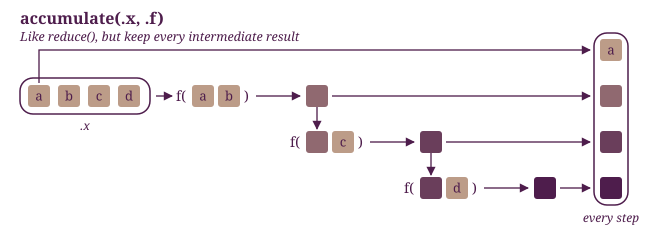

It's not really news if you knew that I have strong opinions against the current models of social media platforms. The current model which relies on the commercialisation of attention and virality is simply unethical in my opinion. I have been avoiding using any kind of social media for a few years now, just for the sake of my own sanity. 

Recently, as I was combatting the urge to engage with these platforms, so I decided to just play some video games, I used to love it when I was younger. I would go every Sunday to an internet shop and play for 2 hours over the intranet of the store with whoever is in there. Half-Life and Counter-Strike were so fun, FIFA 2007 was amazing, and PES 2013 was legendary. 

Those memories inspired me to write (in the future) about games, and the political economy of the current model of social media. Then, as I side quested to redesign this website and showcase my previous work, I realised as I struggled with different decisions, that maybe I should write about that: How decisions are made. Given my struggles, the prisoner's dilemma as a project subject was a perfect sub-sub-side-quest. 

So, to cut the yapping short, the objective of this post is to explore the idea of the prisoner's dilemma, starting from the simplest example of a 2-player game, then building complexity throughout to generalise the concept to a multiplayer game.  


```{r}
#| label: setup
#| message: false
#| code-summary: "Setup: packages, fonts, colours, themes"

# loading my own package
# pak::pak("bennour007/dilemma")
pacman::p_load(tidyverse, tidygraph, dilemma, ggraph, Matrix, showtext, gt)

# Fonts: the site's typeface, registered under the names the themes use
font_add_google("Literata", "literata", regular.wt = 400, bold.wt = 700)
font_add_google("Literata", "literata-800", regular.wt = 800)
showtext_auto()
knitr::opts_chunk$set(fig.showtext = TRUE)

set.seed(5)

# Layer 1: the dictionary
palette <- list(ink = "#4e1d4c", paper = "#ebd3a2")

# Layer 2: n shades from ink, blending at most 45% of the way towards paper
shades <- \(n) colorRampPalette(c(palette$ink, palette$paper))(101)[round(seq(1, 46, length.out = n))]

# Layer 3: roles
state_colours <- c(Cooperator = palette$ink, Defector = palette$paper)

update_geom_defaults("line",  list(colour = palette$ink, linewidth = 0.8))
update_geom_defaults("point", list(colour = palette$ink))
update_geom_defaults("text",  list(colour = palette$ink, family = "literata"))

theme_bmh <- \(base_size = 13) {
  theme_minimal(base_size = base_size, base_family = "literata") +
    theme(
      plot.background     = element_rect(fill = palette$paper, colour = NA),
      panel.grid.major    = element_line(colour = alpha(palette$ink, 0.12), linewidth = 0.3),
      panel.grid.minor    = element_blank(),
      text                = element_text(colour = palette$ink),
      axis.text           = element_text(colour = palette$ink),
      plot.title          = element_text(family = "literata-800", size = rel(1.25),
                                         margin = margin(b = 4)),
      plot.subtitle       = element_text(face = "italic", margin = margin(b = 12)),
      plot.title.position = "plot",
      legend.position     = "bottom",
      legend.title.position = "top",
      legend.justification = "center",
      legend.title =  element_text(hjust = 0.5),
      legend.key.width = unit(1.5, units = "cm"),
      plot.margin         = margin(14, 14, 14, 14)
    )
}

theme_bmh_void <- \(base_size = 13) {
  theme_void(base_size = base_size, base_family = "literata") +
    theme(
      plot.background = element_rect(fill = palette$paper, colour = NA),
      text            = element_text(colour = palette$ink),
      plot.title          = element_text(family = "literata-800", size = rel(1.25),
                                         margin = margin(b = 4)),
      plot.subtitle       = element_text(face = "italic", margin = margin(b = 12)),
      plot.title.position = "plot",
      legend.position     = "bottom",
      legend.title.position = "top",
      legend.justification = "center",
      legend.text.position = "top",
      legend.key.width = unit(1.5, units = "cm"),
      plot.margin         = margin(14, 14, 14, 14)
    )
}

table_bmh <- \(data, ...) {
  data |>
    gt::gt(...) |>
    gt::tab_options(
      table.font.names            = "inherit",
      table.font.color            = palette$ink,
      table.background.color      = "transparent",
      table.border.top.color      = palette$ink,
      table.border.bottom.color   = palette$ink,
      table.border.right.color    = palette$ink,
      table.border.left.color     = palette$ink,
      column_labels.border.bottom.color = palette$ink,
      table_body.hlines.color     = alpha(palette$ink, 0.2),
      table_body.vlines.color     = alpha(palette$ink, 0.2),
      column_labels.font.weight   = "bold"
    )
}


```


## Game 0

The prisoner's dilemma is a simple puzzle, but it provides us with powerful insights into human behaviour when we assume rationality. The puzzle in its simplest form is as follows: two players meet, they have to choose, without knowing each other's decision preference beforehand, whether to cooperate with the other player, or to defect from cooperating. What governs the decision is the reward rules determined by:

- Temptation (T): the payoff of defecting. 
- Reward (R): the payoff of cooperating. 
- Punishment (P): the payoff of mutual defection. 
- Sucker's pay-off (S): the payoff of being exploited (one player cooperates, the other defects)


Essentially, a game with these rules such that:

$$T > R > P \ge S$$

is considered a form of the prisoner's dilemma. The pay-off possibilities for a 2-player game can be summarised in this table below:


```{r}
#| label: table-payoffs

simple_case <- tribble(
  ~` `,        ~`Other cooperates`, ~`Other defects`,
  "I cooperate", "R = 1",             "S = −1",
  "I defect",    "T = 1.2",           "P = 0"
) 
  

simple_case |> 
  table_bmh(rowname_col = " ")
```


We'll build the answer in small steps: first two players and one choice, then a crowd of players who copy each other, and finally players living in networks of different shapes.


## Cheating is tempting

In this game as we set it up, we assume that neither player knows what the other would decide. They would have to rationalise their decision in a way that matches their preferences. Maybe a player would want to get as many points as possible, another may want to avoid risks and not lose instead. 

But in this game, there's only one strategy that both minimises risk and maximises potential gains. We can identify this strategy if we completely ignore what the other player does and focus mainly on the range of payoffs we can get from each of the decisions ahead. In other terms if we sum the payoffs row-wise we get the total payoff of each decision. 

```{r}
#| label: table-total-payoffs

simple_case |> 
  mutate(
    Payoff = c(0, 1.2)
  ) |> 
  table_bmh()
```

In here, because the relationship $T > R > P \ge S$ is satisfied, the only winning strategy is to defect. Because the total payoff of defecting is higher than cooperating. It's tempting to cheat, or in this case betray the other. How Machiavellian. 


Now you may ask this is basic logic, why is this a big deal, where's the dilemma? The answer simply put is that a careful, self-interested (rational) player would decide to defect. The other player reasons in exactly the same way, so both defect and both earn 0, while cooperating would have given each of them 1.

More specifically, the dilemma here is that **what is rational for each player is bad for both.** A classic example I'd like to use in class to explain two paradoxical ideas, that both individualism and central coordination result in sub-optimal results for the individual and the group, someone will have to lose eventually. 


::: {.column-margin}
**Dominant strategy.** A choice that is at least as good as any alternative, whatever the others do. Here, defecting.

**Nash equilibrium.** A situation where no player can do better by changing only their own choice. Here, both defecting: a player who switches to cooperating alone still earns 0, so gains nothing.
:::


## Extending the game to many players

So far in a game with two players, both end up reasoning their way to defecting. However, in reality, people socialise with more than just one peer, and their interactions influence each other's behaviour at least to some extent. 

We can extend our game into the multi-player set up, simply by imposing a very simplistic assumption about how players decide, they will compare their outcome to the outcome of their peers, and copy the strategy that got the best payoff. 

To establish this game and discover how the behavior of its players evolves in each round. In here I will go for 300 rounds with 100 players, and the initial game will dictate the proportion of defectors and cooperators that's assigned to the players at random, then we will tweak what we mean by peers or neighbours. Essentially we will control the number of comparisons each player does. This will require further elaboration that I will go through here and explain how to implement it in R. 

Let's start with a simple case of 6 players, each player will have one peer. This is a simple social network that we can visualise considering a player as a node, with an edge linking it to its peer. We will first assign randomly the decision of each player for the initial game then see what happens after 36 games.  

In the first iteration of this post, I wrote the code directly in here. For more organisation and to streamline the backend, I created the [`dilemma` package](https://github.com/bennour007/dilemma) that help us simulate the experiments. 

For our purposes here, I will not get too much into the details, but I will elaborate progressively as we build complexity. For now, the set up is simple, we generate 6 instances, assign them an initial decision at random such that half the players cooperate, and the other half defect. Then, take that data, and use it to construct a network, such that each player has only one peer to play with, this can be seen in @sp_net. 


```{r}
#| label: six-players

six <- simulate_game(
  network     = one_peer(6),
  prop_defect = 0.5,
  n_rounds    = 10,
  detail      = TRUE
)
```

```{r}
#| label: plot-six-network
#| fig-cap: sp_net

one_peer(6) |>
  mutate(decision = six$decision[six$round == 0]) |>
  ggraph(layout = "circle") +
  geom_edge_link(
    arrow    = arrow(length = unit(3, "mm"), type = "closed"),
    end_cap  = circle(5, "mm"),
    colour   = palette$ink
  ) +
  geom_node_point(
    aes(fill = decision),
    shape  = 21,
    size   = 9,
    colour = palette$ink,
    stroke = 1
  ) +
  scale_fill_manual(values = c(cooperate = palette$ink, defect = palette$paper)) +
  labs(
    title    = "Six players, one peer each",
    subtitle = "Each player plays and compares with the next one around the circle",
    fill     = "Starting decision"
  ) +
  theme_bmh_void()
```

Now, this is the initial state of the game: 6 palyers, 3 defect  and 3 cooperates at round 0. From here, we want to move to the next rounds, each player will look at their neighbour and compare their payoffs, if the difference favors the peer, the player will copy its peer, otherwise it will continue with its strategy. To implement this we need a bit of engineering so bear with me. 

The objective here is literally accumulate the payoffs to move from the initial state to next rounds. The payoff of each previous round is the input for the decision in the next. This is a perfect case for map/reduce functions. These are, in R, vectorised and fast family of functions that replace loops and are extremely efficient. These functions are part of the [`purrr` package](https://rstudio.github.io/cheatsheets/html/purrr.html), probably my favorite tool. In here I will use a variant of the reduce family, perfectly called called `accumulate()`.  



::: {.column-margin}
Diagram adapted from the purrr cheatsheet by Posit Software, PBC (CC BY-SA 4.0).
:::


All we have to do is apply the logic of the function. Each player play a game, makes a decision, the payoff is computed based on the decision of both players, which is used to update the strategy for the next round. The package `dilemma` makes this easy for us to do as the rules are already internaly implemented and tested within the package and in previous iterations of this post. 

With the results obtained from our simulation, we can simply summarise the data by round to see the change in how players adopt the dominant strategy. I will calculate the proportion of defectors in each round. But what can we expect here? 


```{r}
#| label: plot-sp-adoption
#| fig-cap: sp_adoption

six |> 
  mutate(
    decision = if_else(decision == "defect", 1, 0)
  ) |> 
  summarise(
    defectors = mean(decision), 
    .by = round
  ) |> 
  ggplot() +
  geom_line(
    aes(
      x = round, 
      y = defectors
    )
  ) +
  geom_point(
    aes(
      x = round, 
      y = defectors
    )
  ) +
  scale_x_continuous(limits = c(-1, 10), breaks = seq(0, 10, by = 1)) +
  labs(
    title    = "Six players, one peer each",
    subtitle = "Share of defectors in each round",
    x        = "Round",
    y        = "Share of defectors"
  ) +
  theme_bmh()
```

Players in this set up as shown in @sp_adoption shows, quickly change their strategy. By the third round, all players defect. 


## It gets messy

Now, there are different moving parts in here. We can manipulate the initial conditions of the game to explore how the proportion of players adopting the dominant strategy changes. We can increase the number of players, of rounds, and we can change the initial proportions of defectors. 


For convenience, let's see what happens when we have a large group of players, with one single defector. If you expect the same result to happen, everyone eventually defects but after more rounds, you are on the right track. However, since I'm lazy, I don't want to rewrite all the code again or even copy paste it. So I'm simply going to turn it into a function that controls for the number of players, the proportion of defectors and the number of rounds. 

-- EDIT: If you are reading this for the first time, I actually made a package for the experiment so I don't write code in here.


```{r}
#| label: many-players

initial_proportions <- c(0.01, 0.05, 0.1, 0.2)

many_games <- map_df(
  initial_proportions, 
  ~ simulate_game(
      network     = one_peer(100),
      prop_defect = .x,
      n_rounds    = 50,
      detail      = TRUE
  ) |> 
    mutate(initial = .x)
)

```


In this iteration, we simulate for 50 rounds, the same game with 200 players, but we repeat the experiment with diffirent initial conditions with 1% 5% 10% and 20% of players are defectors in round 0. 

```{r}
#| label: many-players-diff-conditions

many_games |> 
  mutate(
    decision = if_else(decision == "defect", 1, 0),
    initial = as.factor(initial)
  ) |> 
  summarise(
    defectors = mean(decision), 
    .by = c(round, initial)
  ) |> 
  ggplot(
    aes(
      x = round, 
      y = defectors
    )
  ) +
  geom_line(aes(linetype = initial)) +
  labs(
    title    = "Defection spreads from any starting point",
    subtitle = "Share of defectors in each round, 200 players with one peer each",
    x        = "Round",
    y        = "Share of defectors",
    # linetype = "Initial share of defectors"
  ) +
  theme_bmh()
```

Great, we have successfully generalised the game to many players that play each round with their unique unitary peers. Still, we can improve this simulation to many other real life conditions. For instance, usually people have multiple peers, and they make mistakes, they can misjudge the success of their peer's strategy. There are different patterns of social interactions, close group of friends, friends centered around one leader, and people who are friends with many groups at the same time. All of these granularity compound the complexity of the simulation, and show us different outcomes for different social architectures. 

Now, how can we implement these ideas? The simplest answer is usually formal and mathematical. But I will not get into too much details unless we really need to. So I will try to decipher this into the most basic ideas first, starting from the different patterns of interaction between people, to the idea of mistakes or uncertainty. 


The reason why I chose to write this post in this way is because it sits at the intersection of concepts that really interest me. Networks, probabilities, games, and simulations. We started this post with the simplest game, then extended the game to many players, we simulated it and showed that even when we have a very small number of defectors, everyone will eventually choose to copy the dominant strategy and defect. 

To extend this further, I want to discuss different patterns of social networks. These patterns are very interesting because they inform us on how people interact, and that also changes the way the game evolves. You would be right to assume that eventually all players defect. 

But before we get into the details let's reason our way through this. Usually, there are two questions that determine the patterns of interactions between people in a community.

1. How many friends does the typical person have? 
2. Do my friends know each other? 

From these two questions, we can build distributions of connections. In this version we want to have a more realistic description of how people interact. Albeit realistic here is a bit of a stretch, because I will still use simulated data. There's a wealth of actual network data sets on the web, but I want to practice simulating data more through this. You are stuck with my side quest this time. 

Let's start with an example, one person. How can we model the relationship of a typical person? Well, since the number of friends is essentially a count we can rely on the Poisson distribution for that. For the non-close friends, the negative binomial is a better fit. Let's see how a sample of 200 players would look like if we assume that the average count of close friends is 4, and the other acquaintances is 2. 

However, to keep things simple for now, let's just focus on how the game evolves when we have different shapes of social network that answer the two questions above differently. I promise the probabilistic part would be in another post. 

Now, we can move forward and build our network of players. We will do the same thing as the previous versions, only this time, each player will have different peers to play the game with and the number of these peers, how connected they are together and how clustered they are is given by network parameters that we will set up. But before we decide on all this, maybe we should first take a look at some different network pattern. Thankfully, the [`tidygraph()` package](https://tidygraph.data-imaginist.com/reference/index.html) provides a large number of functions that generates some predetermined and well known networks. We will use that to establish the main ideas that concern our simulation. 

## Three kinds of networks

So far every player had a single peer. Real friendships come in shapes: tight groups, groups with a few bridges between them, and a handful of people who seem to know everyone. Here are three network models that capture these shapes, each with 24 players. In each plot, a circle is a player, a line is a friendship, and larger circles have more friends.

```{r}
#| label: plot-network-helper

plot_network <- function(network, title, subtitle) {
  network |>
    mutate(friends = centrality_degree()) |>
    ggraph(layout = "stress") +
    geom_edge_link(colour = alpha(palette$ink, 0.4)) +
    geom_node_point(
      aes(size = friends),
      shape  = 21,
      fill   = palette$paper,
      colour = palette$ink,
      stroke = 1
    ) +
    scale_size(range = c(2, 7), guide = "none") +
    labs(title = title, subtitle = subtitle) +
    theme_bmh_void()
}
```

::: {.column-margin}
In all three networks, players have about 4 friends on average, so the networks differ in shape, not in size.
:::


::: {.panel-tabset}

### Blocks

Blocks work like islands, but with more freedom: groups can have different sizes, and every pair of groups gets its own probability of a friendship. Here each group is a closed circle of friends who all know each other, and friendships across groups are rare.

```{r}
#| label: plot-blocks

set.seed(1)

blocks <- play_blocks(
  n           = 24, 
  loops = F, 
  size_blocks = rep(4, 6),               # six groups of four
  p_between   = 0.05 + diag(0.95, 6),    # 1 inside a group, 0.05 between groups
  directed    = FALSE
)

plot_network(
  blocks,
  title    = "Blocks",
  subtitle = "Six close groups of four, with rare friendships between groups"
)
```

### Barabási–Albert

This network has no groups at all. It grows one player at a time, and each newcomer befriends existing players, preferring those who already have many friends. The rich get richer: the earliest players become hubs with many friends, while most players have only a few.

```{r}
#| label: plot-barabasi

set.seed(1)

barabasi <- play_barabasi_albert(
  n        = 24,
  power    = 1,     # the chance of being befriended grows with the friends you have
  growth   = 2,     # each newcomer makes two friends
  directed = FALSE
)

plot_network(
  barabasi,
  title    = "Barabási–Albert",
  subtitle = "No groups, but a few hubs with many friends"
)
```

:::


We can now run the experiment again for these three  network patterns. 

The only difference here is that instead of player comparing its payoff to one peer, it will do so with all its peers instead. So we need to specify what number the player is going to use as benchmark. We can see the average, the median, or we can choose a random peer. Let's go. 


```{r}
#| label: all-networks

set.seed(1)

# islands <- play_islands(
#   n_islands    = 25,     # 25 groups
#   size_islands = 8,     # of 8 players each
#   p_within     = 0.6,   # chance two islanders are friends
#   m_between    = 1      # one bridge between each pair of islands
# )

blocks <- play_blocks(
  n           = 200,
  size_blocks = rep(25, 8),               # six groups of four
  p_between   = 0.05 + diag(0.95, 8),    # 1 inside a group, 0.05 between groups
  directed    = FALSE
)

barabasi <- play_barabasi_albert(
  n        = 200,
  power    = 1,     # the chance of being befriended grows with the friends you have
  growth   = 4,        # each newcomer makes two friends
  directed = FALSE
)

b_rules <- c("mean", "median", "random", "sum")
```

::::: {.column-page}

:::: {.panel-tabset}

## Blocks

::: {.columns}


::: {.column width="65%"}
```{r}
#| label: plot-blocks-game
#| warning: false


plot_network(
  blocks,
  title    = "Blocks",
  subtitle = "Close groups, with rare friendships between groups"
)

many_games_blocks <- map_df(
  b_rules, 
  ~ simulate_game(
      network     = blocks,
      prop_defect = 0.05,
      rule        = .x,
      n_rounds    = 50,
      detail      = TRUE
  ) |> 
    mutate(rule = .x)
)

many_games_blocks |> 
  mutate(
    decision = if_else(decision == "defect", 1, 0),
    rule = as.factor(rule)
  ) |> 
  summarise(
    defectors = mean(decision), 
    .by = c(round, rule)
  ) |> 
  ggplot(
    aes(
      x = round, 
      y = defectors
    )
  ) +
  geom_line(aes(linetype = rule)) +
  scale_linetype_manual(
    values = c(mean = "solid", median = "dashed", random = "dotted", sum = "dotdash")
  ) +
    scale_x_continuous(limits = c(-1, 10), breaks = seq(0, 10, by = 5)) +
  labs(
    title    = "Defection on a network of blocks",
    subtitle = "Share of defectors in each round, starting from 5% defectors",
    x        = "Round",
    y        = "Share of defectors",
    linetype = "Benchmark"
  ) +
  theme_bmh()
```
:::

::: {.column width="35%"}
In this network, players live in small close groups of five, where everyone knows everyone. Now and then, someone has a friend from another group, but that's rare.

When players benchmark with the mean, the random peer, or the sum, defection takes over quickly. But with the median, nothing moves at all, the few defectors we started with stay alone, and nobody copies them.

Let's take one group to see why. Four cooperators and one defector. Each cooperator plays three games with the other cooperators, one with the defector, and a couple more with friends outside, so their payoffs look like 1, 1, 1, −1, 1, 1. The defector wins every game, 1.2 each time.

With the mean, the one loss pulls the cooperator's score down to about 0.67, while the defector's 1.2 pulls the average of the peers up. The peers did better, so the cooperator copies the defector.

With the median, the one loss doesn't count, the cooperator's score stays at 1. And the defector is just one peer among many, so the median of the peers is also 1. Nobody did better, so nobody switches. The defector is an outlier, and the median simply ignores outliers. For defection to spread here, more than half of your peers need to be doing better than you.
:::

:::

## Barabási–Albert

::: {.columns}

::: {.column width="65%"}
```{r}
#| label: plot-barabasi-game
#| warning: false


plot_network(
  barabasi,
  title    = "Barabási–Albert",
  subtitle = "No groups, but a few hubs with many friends"
)

many_games_barabasi <- map_df(
  b_rules, 
  ~ simulate_game(
      network     = barabasi,
      prop_defect = 0.05,
      rule        = .x,
      n_rounds    = 50,
      detail      = TRUE
  ) |> 
    mutate(rule = .x)
)

many_games_barabasi |> 
  mutate(
    decision = if_else(decision == "defect", 1, 0),
    rule = as.factor(rule)
  ) |> 
  summarise(
    defectors = mean(decision), 
    .by = c(round, rule)
  ) |> 
  ggplot(
    aes(
      x = round, 
      y = defectors
    )
  ) +
  geom_line(aes(linetype = rule)) +
  scale_linetype_manual(
    values = c(mean = "solid", median = "dashed", random = "dotted", sum = "dotdash")
  ) +
  scale_x_continuous(limits = c(-1, 20), breaks = seq(0, 20, by = 5)) +
  labs(
    title    = "Defection on a Barabási–Albert network",
    subtitle = "Share of defectors in each round, starting from 5% defectors",
    x        = "Round",
    y        = "Share of defectors",
    linetype = "Benchmark"
  ) +
  theme_bmh()
```
:::

::: {.column width="35%"}
This network has no groups. It grows one player at a time, and newcomers prefer to befriend players who already have many friends. So a few players become hubs, while most players have only a couple of friends.

Here, the random peer ends with everyone defecting, the mean stops at around 75%, the sum at around 27%, and the median at around 10%, wobbling a bit as a few players keep switching back and forth.

The hubs explain most of this. Take a hub with ten friends, all cooperators. It plays ten games and earns 1 in each. Now take one of its friends who defects, and has only one other friend, also a cooperator. The defector earns 1.2 twice.

With the mean, the hub scores 1 and the defector 1.2. The defector looks more successful, so defection spreads.

With the sum, the hub scores 10 and the defector 2.4. Now the hub looks far more successful, and its friends keep copying cooperation. The hub's many friendships protect cooperation around it, and that's why so many players are still cooperating at the end.
:::

:::

::::

:::::


This was more fun than I actually expected. Cheers.!
